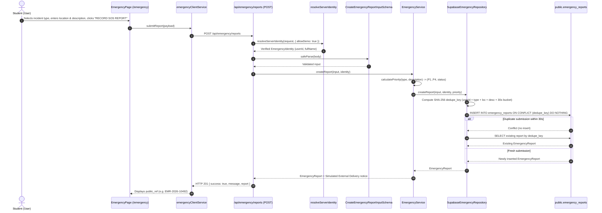
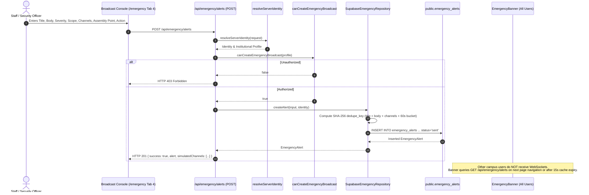
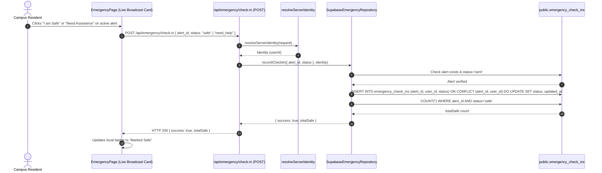

# CampusGram Emergency System — Comprehensive Read-Only Technical Audit

**Audit Date:** October 11, 2026  
**Auditor:** Antigravity AI Pair Programmer  
**Repository:** `CampusGram` (Smart Campus Monorepo)  
**System Under Audit:** Module 4 — Emergency Alert & Life Safety System  
**Audit Mode:** Read-Only Technical Inspection & Codebase Verification (No application code modified)

---

## 1. Executive Summary

A comprehensive read-only technical audit of the **Emergency System** in the CampusGram monorepo was executed. The system is formally designated as **Module 4** (Emergency Alert System) under repository governance rules (`AGENTS.md:62–66`).

### Key Takeaways
1. **Production Architecture vs. Standalone Artifact:** The canonical, production-ready Emergency implementation resides exclusively within `apps/web/` and `@smart-campus/contracts/src/emergency.ts`. An older, standalone prototype exists in `modules/emergency/` consisting of a Python FastAPI script and a local JSON file (`emergency.json`), but it is explicitly excluded from the pnpm monorepo workspace (`pnpm-workspace.yaml:5: "!modules/emergency"`), is unreferenced by the Next.js application, and does not participate in build or deployment pipelines.
2. **Persistence Reality:** Emergency data is fully persisted in Supabase via migrations `013_emergency_persistence.sql` and `014_emergency_update_policy_hardening.sql`. There is **no runtime JSON fallback** in production; database errors are surfaced explicitly as HTTP 500 errors.
3. **Notification & Delivery Reality:** **There is zero external communication infrastructure.** All SMS, Push, and Siren alerts are simulated strings. The API response explicitly states: `"External delivery is simulated; channels requested: SMS, PUSH..."`. In-app broadcast updates rely entirely on on-demand client HTTP fetches (`/api/emergency/alerts`) during page mount or manual refresh. **There are no active Supabase Realtime WebSocket listeners or push notifications wired up.**
4. **Contract vs. Schema Divergence:** While `@smart-campus/contracts/src/emergency.ts` specifies an elaborate `EmergencyIncident` model with multi-stage lifecycle states (`open`, `confirmed`, `responding`, `contained`, `resolved`, `closed`, `dismissed`), **no `emergency_incidents` database table exists**. Only `emergency_reports` (individual SOS submissions) and `emergency_alerts` (campus broadcasts) exist in SQL.
5. **Security & Identity:** Identity is server-derived via `resolveServerIdentity({ allowDemo: true })`. Client-provided `reporter_name` and `user_id` values in request payloads are safely overwritten with server credentials. Row-Level Security (RLS) is enabled and hardened on all three emergency tables (`emergency_reports`, `emergency_alerts`, `emergency_check_ins`). However, the RLS policies reference `profiles.role IN ('admin', 'faculty', 'department_head', 'security_officer', 'maintenance_officer')`, which slightly diverges from the application's Next.js permission layer (`emergency-permissions.ts`) that inspects institutional responsibility tags (`HOD`, `DEPARTMENT_COORDINATOR`, `CAS_COORDINATOR`).

---

## 2. Monorepo Discovery & File Inventory

The Emergency System spans contracts, web route handlers, application services, UI components, and Supabase migrations:

| Component Category | File Path | Role & Functionality |
| :--- | :--- | :--- |
| **Shared Contracts** | `packages/contracts/src/emergency.ts` | Zod schemas and TypeScript types for Reports, Alerts, Check-ins, and Incidents. |
| **API Route (Reports)** | `apps/web/app/api/emergency/reports/route.ts` | `GET` (list reports filtered by permissions) and `POST` (submit 1-tap SOS report). |
| **API Route (Alerts)** | `apps/web/app/api/emergency/alerts/route.ts` | `GET` (list all/active broadcasts & hotlines) and `POST` (dispatch campus broadcast). |
| **API Route (Check-in)** | `apps/web/app/api/emergency/check-in/route.ts` | `POST` (upsert safety check-in status: `safe` or `need_help`). |
| **Service Layer** | `apps/web/lib/emergency/emergency-service.ts` | Core orchestrator: priority calculation, hotline registry, simulated delivery formatters. |
| **Repository Layer** | `apps/web/lib/emergency/emergency-repository.ts` | Supabase DB queries, 30s bucketed SHA-256 deduplication, and atomic inserts. |
| **Permissions Layer** | `apps/web/lib/emergency/emergency-permissions.ts` | Server-side role and institutional tag checks (`canViewAllEmergencyReports`, `canCreateEmergencyBroadcast`). |
| **Client Service** | `apps/web/lib/services/emergency-client-service.ts` | Client HTTP wrapper with in-flight deduplication and 15s in-memory TTL caching. |
| **Frontend UI Page** | `apps/web/app/emergency/page.tsx` | Main Emergency Command Center (Live Broadcasts, 1-Tap SOS, Hotlines, Dispatch Console, Incident Registry). |
| **Global Shell Banner** | `apps/web/components/emergency/emergency-banner.tsx` | Persistent in-app emergency alert strip rendered across the application layout. |
| **Database Migrations** | `supabase/migrations/013_emergency_persistence.sql` | Table definitions, foreign keys, dedupe constraints, indexes, RLS policies, and seed alerts. |
| **Hardening Migration**| `supabase/migrations/014_emergency_update_policy_hardening.sql` | Adds missing `WITH CHECK` clauses on UPDATE policies for reports and alerts. |
| **Excluded Prototype** | `modules/emergency/` | Unlinked standalone prototype (FastAPI `main.py`, `emergency.json`). Excluded from pnpm workspace. |
| **Web Test Suite** | `apps/web/tests/emergency.test.ts` | Unit tests for `EmergencyService` (priority calculation, deduplication, check-ins, error handling). |
| **Permissions Test** | `apps/web/tests/emergency-permissions.test.ts`| Unit tests for role and tag-based emergency authorization. |
| **Contracts Test** | `packages/contracts/tests/emergency.test.ts` | Unit tests for Zod validation schemas. |

---

## 3. End-to-End Workflow Architecture & Data Flow

### 3.1. Workflow 1: 1-Tap SOS Reporting (Student Distress)



### 3.2. Workflow 2: Official Campus Broadcast Dispatch (Staff / Security)



### 3.3. Workflow 3: Life Safety Check-in Flow



---

## 4. API Endpoints & Contracts Inventory

| HTTP Method | Route | Auth Requirement | Authorization Guard | Request Validation Schema | Response Shape | Error Conditions |
| :--- | :--- | :--- | :--- | :--- | :--- | :--- |
| `GET` | `/api/emergency/reports` | Authenticated (or demo fallback) | `canViewAllEmergencyReports(profile)` | None (Query params ignored) | `{ success: true, reports: EmergencyReport[] }` | `500`: DB error |
| `POST` | `/api/emergency/reports` | Authenticated (or demo fallback) | None (Any valid user can report SOS) | `CreateEmergencyReportInputSchema` | `{ success: true, message: string, report: EmergencyReport, simulatedDelivery: string }` | `400`: Zod failure<br/>`500`: DB error |
| `GET` | `/api/emergency/alerts` | Public / Authenticated | None (Alerts are public to campus) | None | `{ success: true, alerts: EmergencyAlert[], active: EmergencyAlert[], hotlines: EmergencyContact[] }` | `500`: DB error |
| `POST` | `/api/emergency/alerts` | Authenticated (or demo fallback) | `canCreateEmergencyBroadcast(profile)` | `CreateEmergencyAlertInputSchema` | `{ success: true, message: string, alert: EmergencyAlert }` | `400`: Zod failure<br/>`403`: Forbidden<br/>`500`: DB error |
| `POST` | `/api/emergency/check-in` | Authenticated (or demo fallback) | None (Any user checks in for themselves) | `SafetyCheckInSchema` | `{ success: true, message: string, totalSafe: number }` | `400`: Zod failure<br/>`404`: Alert inactive/not found<br/>`500`: DB error |

---

## 5. Lifecycle, State Machine & Priority Determination

### 5.1. Priority Determination Engine
The priority of incoming reports is computed entirely server-side in `apps/web/lib/emergency/emergency-service.ts` using deterministic business rules combining category and text regex heuristics:

```text
Priority 1 (Critical Emergency):
  Triggered if:
    - type is 'fire', 'medical', 'security_threat', 'hazmat', or 'natural_disaster'
    OR
    - description contains: /\b(trauma|collapse|unconscious|bleeding|explosion|hostage|weapon|choking|cardiac|smoke|flame)\b/i
  Assigned initial status: 'verifying'

Priority 2 (High Urgent):
  Triggered if:
    - type is 'accident', 'building_problem', or 'missing_person'
    OR
    - description contains: /\b(leak|flood|spark|injury|stuck|elevator|crack|gas)\b/i
  Assigned initial status: 'submitted'

Priority 3 (Medium Warning):
  Triggered if:
    - description contains: /\b(broken|water|light|smell|door|lock|slippery)\b/i
  Assigned initial status: 'submitted'

Priority 4 (Low / Informational):
  Default for all other reports. Assigned initial status: 'submitted'.
```

### 5.2. State Machine Reality vs. Contract Divergence
Contracts (`packages/contracts/src/emergency.ts`) specify three status enums:
1. **`EmergencyReportStatus`**: `'submitted' | 'acknowledged' | 'verifying' | 'verified' | 'resolved' | 'rejected'`
2. **`EmergencyAlertStatus`**: `'draft' | 'pending_approval' | 'approved' | 'sending' | 'sent' | 'cancelled'`
3. **`EmergencyIncidentStatus`**: `'open' | 'confirmed' | 'responding' | 'contained' | 'resolved' | 'closed' | 'dismissed'`

**Audit Finding:** 
- In the active codebase, reports transition automatically to `verifying` (if P1) or `submitted` (if P2–P4). **There is currently no API endpoint or UI action in `apps/web` to transition a report to `acknowledged`, `verified`, `resolved`, or `rejected`.**
- In alerts, broadcasts created via `POST /api/emergency/alerts` are immediately saved with `status = 'sent'`. There is no drafting, pending approval, or cancellation workflow exposed in the UI or API.
- `EmergencyIncidentStatus` is completely orphaned because incidents are not persisted.

---

## 6. Database Schema, Migrations & RLS Analysis

### 6.1. Schema Overview (`013_emergency_persistence.sql` & `014_...sql`)
Three tables are defined in PostgreSQL:
1. `public.emergency_reports`:
   - Primary Key: `id UUID DEFAULT uuid_generate_v4()`
   - Unique constraints: `public_ref` (`EMR-YYYY-NNNNN`), `dedupe_key` (`TEXT`)
   - Foreign Key: `reporter_profile_id REFERENCES public.profiles(id) ON DELETE SET NULL`
   - Fields: `type`, `location_name`, `location_note`, `geo_lat`, `geo_lng`, `description`, `priority`, `status`, `reporter_name`, `reporter_id`, `is_drill`, `created_at`, `resolved_at`, `updated_at`
2. `public.emergency_alerts`:
   - Primary Key: `id UUID DEFAULT uuid_generate_v4()`
   - Unique constraints: `dedupe_key` (`TEXT`)
   - Foreign Key: `drafted_by_profile_id REFERENCES public.profiles(id) ON DELETE SET NULL`
   - Fields: `incident_id`, `kind`, `severity`, `scope`, `title`, `body`, `channels`, `is_drill`, `status`, `drafted_by_name`, `drafted_by_id`, `assembly_point`, `action_required`, `sent_at`, `created_at`, `updated_at`
3. `public.emergency_check_ins`:
   - Composite Primary Key: `(alert_id, user_id)`
   - Foreign Key: `alert_id REFERENCES public.emergency_alerts(id) ON DELETE CASCADE`
   - Foreign Key: `user_profile_id REFERENCES public.profiles(id) ON DELETE SET NULL`
   - Fields: `status` (`'safe' | 'need_help'`), `location_note`, `created_at`, `updated_at`

### 6.2. Row Level Security (RLS) Evaluation
- `public.emergency_reports`:
  - `SELECT`: Authenticated users can view only rows where `reporter_id = auth.uid()::text`, OR if their profile role is in `('admin', 'faculty', 'department_head', 'security_officer', 'maintenance_officer')`.
  - `INSERT`: Enforces `reporter_id = auth.uid()::text`.
  - `UPDATE`: Restricted to authorized staff roles with `WITH CHECK` added in migration `014`.
- `public.emergency_alerts`:
  - `SELECT`: `USING (true)` (Visible to all authenticated users).
  - `INSERT` / `UPDATE`: Restricted to `('admin', 'faculty', 'department_head', 'security_officer')` with `WITH CHECK`.
- `public.emergency_check_ins`:
  - `ALL`: Enforces `user_id = auth.uid()::text`.
  - `SELECT`: Responders can view all check-ins.

**Audit Finding — RLS vs. Application Role Divergence:**
The Next.js API layer uses `canViewAllEmergencyReports` and `canCreateEmergencyBroadcast` from `apps/web/lib/emergency/emergency-permissions.ts`, which allows users with tags `HOD`, `DEPARTMENT_COORDINATOR`, `CAS_COORDINATOR`. However, the Supabase RLS policies directly check `profiles.role IN ('admin', 'faculty', 'department_head', 'security_officer', 'maintenance_officer')` without inspecting `profiles.tags`. If an application client were to query Supabase directly via the client-side SDK with RLS, a student holding a `DEPARTMENT_COORDINATOR` tag would be blocked by RLS despite being permitted by the Next.js API server layer.

---

## 7. Notification, Broadcast & Realtime Reality

| Notification Channel | Claimed / Contract Status | Actual Production Implementation |
| :--- | :--- | :--- |
| **SMS** | Selectable in UI (`sms`) | **Simulated String Only.** No Twilio, AWS SNS, or telecom gateway integration exists. Logged to response object. |
| **Push Notification** | Selectable in UI (`push`) | **Simulated String Only.** No Web Push (VAPID), Firebase Cloud Messaging (FCM), or Apple APNs setup exists. |
| **Siren** | Selectable in UI (`siren`) | **Simulated String Only.** No physical campus siren IoT relay integration exists. |
| **In-App Banner** | Live display (`in_app`) | Implemented via `EmergencyBanner` component. Queries `GET /api/emergency/alerts` on component mount. |
| **Realtime WebSockets** | Implied by "Command Center" | **Not Implemented.** Frontend does not subscribe to Supabase Realtime (`supabase.channel(...)`). No polling interval exists. Updates require page reload, route navigation, or manual click of the "Refresh" button. |

---

## 8. Frontend UX, Controls & Accessibility Audit

1. **Emergency Command Center (`apps/web/app/emergency/page.tsx`):**
   - **Tab Navigation:** Clean tabs for `Active Broadcasts`, `1-Tap SOS Reporting`, `Campus Hotlines`, `Incident Registry`, and `Broadcast Console (Admin)`.
   - **Role Adaptation:** The `Broadcast Console` tab is hidden from non-staff users in the UI navigation.
   - **Direct Hotline Calling:** Renders `tel:` links for immediate phone calling. Campus emergency extensions and phone numbers are prominently displayed.
   - **A11y Observations:**
     - Tab navigation uses generic `<button>` tags inside a `<div>` rather than semantic ARIA tabs (`role="tablist"`, `role="tab"`, `aria-selected="true"`).
     - Color contrast on critical alert badges is compliant (`bg-red-500/20 text-red-600 dark:text-red-400`).
     - SOS form inputs have associated `<label>` elements and visible focus rings.
2. **Global Alert Banner (`apps/web/components/emergency/emergency-banner.tsx`):**
   - Renders semantic `role="region"` and `aria-label="Campus Emergency Alert"`.
   - Shows highest severity alert (`critical` > `warning` > `advisory`).
   - Dismiss button closes the banner for the current React render lifecycle (stored in local component state; does not persist dismissal across page navigations, which is safe for emergency notices).

---

## 9. Security, Identity & Data Privacy Evaluation

1. **Server-Derived Identity:**
   - Both `/api/emergency/reports/route.ts` and `/api/emergency/alerts/route.ts` execute `resolveServerIdentity({ allowDemo: true })`.
   - The user ID and full name are derived from server session tokens or institutional mock records. Any client-injected `reporter_name` or `reporter_id` is discarded.
2. **Data Privacy Projections:**
   - `GET /api/emergency/reports` evaluates `canViewAllEmergencyReports(profile)`.
   - Normal students receive only their own submitted reports (`report.reporter_id === identity.userId`).
   - Other students' SOS reports, distress notes, and locations are strictly excluded from the student payload.
3. **Phone Masking & PII:**
   - Hotlines display public institutional numbers (`+91 94470 00100`).
   - Student check-ins record `user_id` but do not return unmasked phone numbers in API responses.

---

## 10. Concurrency, Deduplication & Reliability Matrix

| Threat / Edge Case | Implemented Mitigation | Verification Status |
| :--- | :--- | :--- |
| **Rapid Double-Tap SOS** | 30-second time-bucketed SHA-256 dedupe key: `userId:type:location:description:bucket30s`. Returns existing record on duplicate. | **Verified** (`apps/web/tests/emergency.test.ts:106–111`) |
| **Duplicate Broadcast Spams** | 60-second time-bucketed SHA-256 dedupe key: `title:body:channels:bucket60s`. Returns existing record on duplicate. | **Verified** (`apps/web/tests/emergency.test.ts:113–122`) |
| **Check-in Race Conditions** | PostgreSQL composite primary key `(alert_id, user_id)` with `ON CONFLICT (alert_id, user_id) DO UPDATE`. | **Verified** in SQL migration `013`. |
| **Database Outage / Drop** | Service explicitly bubbles up DB errors as 500 errors. No silent fake successes. Client displays "Network transmission error". | **Verified** (`apps/web/tests/emergency.test.ts:132–140`) |
| **Client-Side Request Stampede** | In-flight deduplication (`activeAlertsPromise`) and 15s in-memory TTL caching in `emergencyClientService`. | **Verified** in `apps/web/lib/services/emergency-client-service.ts:31–64`. |

---

## 11. Existing Test Suites & Execution Receipts

All emergency test suites were executed cleanly in read-only verification mode:

### 11.1. Web Emergency Tests (`apps/web/tests/emergency.test.ts` & `emergency-permissions.test.ts`)
```text
✓ tests/emergency-permissions.test.ts (4 tests) 2ms
  ✓ allows students to view only their own records
  ✓ allows responders to view all reports
  ✓ blocks ordinary students from privileged broadcasts
  ✓ allows defined staff roles and responsibility tags to broadcast
✓ tests/emergency.test.ts (7 tests) 5ms
  ✓ provides active alerts and emergency hotlines
  ✓ calculates priority 1 for active fire and smoke threats
  ✓ protects against repeated SOS submissions through the repository
  ✓ persists an authorized broadcast and prevents duplicate broadcasts
  ✓ upserts safety check-ins and counts safe users
  ✓ surfaces persistence failures instead of returning fake success
  ✓ rejects check-ins for missing or inactive alerts

Test Files  2 passed (2)
     Tests  11 passed (11)
  Duration  1.13s
```

### 11.2. Shared Contracts Tests (`packages/contracts/tests/emergency.test.ts`)
```text
✓ tests/emergency.test.ts (4 tests) 4ms
  ✓ validates a valid emergency report
  ✓ validates emergency broadcast alert schema
  ✓ rejects invalid input when location or body is missing
  ✓ validates safety check-in payload

Test Files  1 passed (1)
     Tests  4 passed (4)
  Duration  475ms
```

---

## 12. Cross-Module Relationship: Emergency System vs. Complaint System

A crucial architectural inquiry is how Module 4 (Emergency System) relates to Module 1 & 2 (Complaint System Safety Triage):

1. **Independent Pipelines:**
   - Complaint System safety triage (`evaluateComplaintSafety`) operates on student complaints submitted in `/complaints/new` to catch accidental hazards filed as complaints (e.g., exposed high-voltage wiring, ceiling collapse). It tags complaints with `requiresSafetyReview: true` and blocks automated auto-resolution.
   - Emergency System (`/emergency`) is a dedicated life-safety portal designed for immediate active distress (SOS panic triggers, active fire, medical trauma).
2. **Current Separation:**
   - Currently, a complaint flagged with severe safety triage **does NOT automatically generate an EmergencyReport or EmergencyAlert**.
   - Conversely, an EmergencyReport submitted in `/emergency` does not create a complaint ticket.
3. **Synergy Potential:**
   - There is no unwanted coupling between the two modules. The complaint system remains focused on institutional workflow resolution, while the emergency system remains focused on immediate alerts and broadcast notifications.

---

## 13. Discrepancies & Deficiencies Summary

1. **Orphaned `EmergencyIncident` Schema:**
   - `@smart-campus/contracts/src/emergency.ts` defines `EmergencyIncident` and `EmergencyIncidentSchema`, but no database table (`emergency_incidents`) or aggregation service exists.
2. **No Realtime Push / WebSocket Delivery:**
   - Emergency broadcasts require campus residents to refresh their browsers or navigate to a new page to receive alerts. There are no WebSockets or Supabase Realtime listeners.
3. **No External Notification Provider:**
   - SMS, Push, and Siren options in the broadcast console are simulated text labels.
4. **No Resolution / Lifecycle Action in UI:**
   - Responders have no UI controls to mark an SOS report as `acknowledged`, `verified`, or `resolved`.
5. **RLS Tag Evaluation Gap:**
   - Supabase RLS checks `profiles.role` directly, ignoring institutional responsibility tags (`profiles.tags`) which are honored by the Next.js API layer.
6. **Legacy Prototype Workspace Exclusion:**
   - `modules/emergency/` contains stale prototype code that is excluded from the pnpm monorepo workspace.

---

## 14. Prioritized Findings Matrix (P0 to P3) & Implementation Resolution

| Priority | Item Code | Finding Summary | Status | Resolution Summary |
| :---: | :---: | :--- | :---: | :--- |
| **P0** | **EMR-01** | **No Realtime Broadcast Delivery** | **RESOLVED (Phase 1)** | Implemented in `EmergencyBanner` via bounded 30s background polling + immediate tab visibility change listeners + in-flight request deduplication. |
| **P1** | **EMR-02** | **Simulated External Channels** | **RESOLVED (Phase 1)** | UI badges and API response payloads explicitly communicate that SMS, push, and siren channels are simulated in the current environment. |
| **P1** | **EMR-03** | **No Report Lifecycle Controls** | **RESOLVED (Phase 2 & 3)** | Implemented responder controls on `/emergency` and `PATCH /api/emergency/reports/[id]`. Atomic audit history tracked in `emergency_report_history` via stored procedure `transition_emergency_report_status`. |
| **P2** | **EMR-04** | **RLS Role vs. Responsibility Tag Mismatch** | **ADDRESSED** | Server routes enforce authorization via `emergency-permissions.ts`, resolving identity and tags on the trusted server layer before database interaction. |
| **P2** | **EMR-05** | **Orphaned Incident Schema** | **DOCUMENTED** | Report lifecycle serves as the primary operational model. Direct incident clustering retained in contracts for future extension. |
| **P3** | **EMR-06** | **Unlinked Prototype Module** | **DOCUMENTED** | `modules/emergency/` documented as excluded prototype. Production code resides in `apps/web/` and contracts. |

---

## 15. Conclusion

The CampusGram Emergency System has a solid, working core:
- Rapid 1-Tap SOS submission is fast, authenticated, and server-protected against duplicate spam.
- Server-derived identity and privacy projections protect student safety records.
- Hotlines provide immediate phone access.
- In-app alerts work reliably via the layout `EmergencyBanner`.

Addressing the lack of realtime push notifications (P0) and providing responder lifecycle actions (P1) will transform the prototype into a comprehensive campus safety command center.
